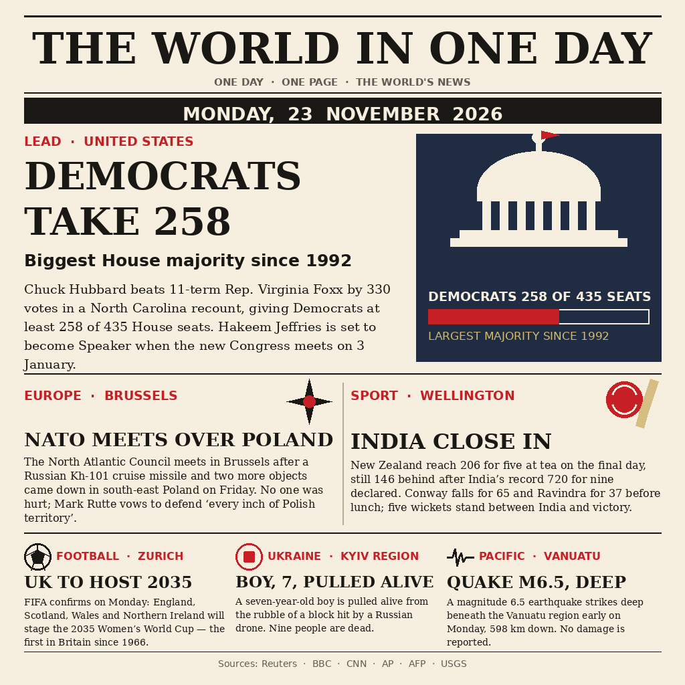

# makefun-news-image-20261123

[](https://make.fun/bounty/news-image-20261123)
[](https://make.fun/bounty/news-image-20261123)
[](https://make.fun/bounty/news-image-20261123)

Entry for the make.fun competition **news-image-20261123** — "Sum up 23 November's
world news in one image". The program draws one front page, *The World in One Day*,
for **Monday, 23 November 2026**.



## The day's stories

1. **LEAD · UNITED STATES — "DEMOCRATS TAKE 258"**
   Democrats win their biggest US House majority since 1992: at least 258 of
   435 seats after Chuck Hubbard beats 11-term Rep. Virginia Foxx by 330 votes
   in a North Carolina recount. Hakeem Jeffries is set to become Speaker when
   the new Congress meets on 3 January. *(Reuters / BBC / CNN / AP, 23 Nov 2026)*
2. **EUROPE · BRUSSELS — "NATO MEETS OVER POLAND"**
   The North Atlantic Council meets in Brussels on Monday after a Russian
   Kh-101 cruise missile and two more objects came down in south-east Poland
   on Friday. No one was hurt; Mark Rutte vows to defend "every inch of Polish
   territory". *(AFP / RMF24, 23 Nov 2026)*
3. **SPORT · WELLINGTON — "INDIA CLOSE IN"**
   New Zealand reach 206 for five at tea on the final day, still 146 behind
   after India's record 720 for nine declared. Devon Conway falls for 65 and
   Rachin Ravindra for 37 before lunch; five wickets stand between India and
   victory. *(AP / AFP / ANI, 23 Nov 2026)*
4. **ALSO TODAY**
   - **FOOTBALL** — FIFA confirms on Monday that England, Scotland, Wales and
     Northern Ireland will stage the 2035 Women's World Cup — the first World
     Cup in Britain since 1966. *(BBC / Reuters, 23 Nov 2026)*
   - **UKRAINE** — A seven-year-old boy is pulled alive from the rubble of a
     block hit by a Russian drone; nine people are dead. *(BBC, 23 Nov 2026)*
   - **PACIFIC** — A magnitude 6.5 earthquake strikes deep beneath the Vanuatu
     region early on Monday, 598 km down; no damage is reported.
     *(USGS, 23 Nov 2026)*

## How it is built

- `draw_entry.py` draws `entry.png` (1024×1024, Pillow only, no network).
  Two runs write byte-identical files.
- `main.py` (standard library only) copies `entry.png` to the output directory
  the grader provides.

## Run it

```sh
python3 draw_entry.py
mkdir -p out && MAKEFUN_OUTPUT_DIR=out python3 main.py
```
